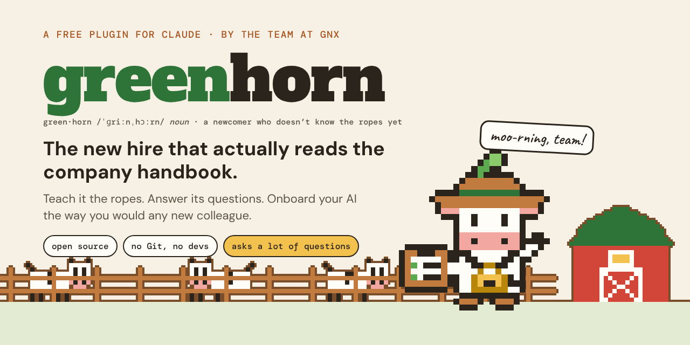
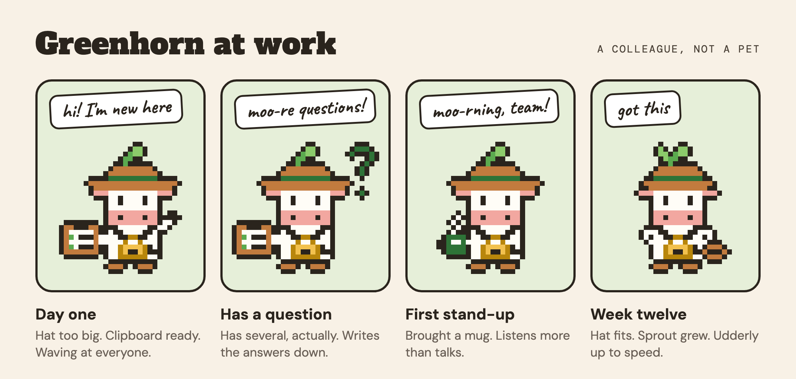
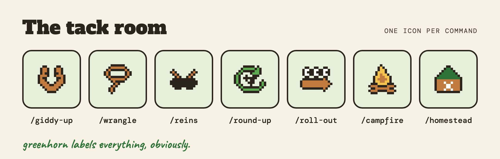
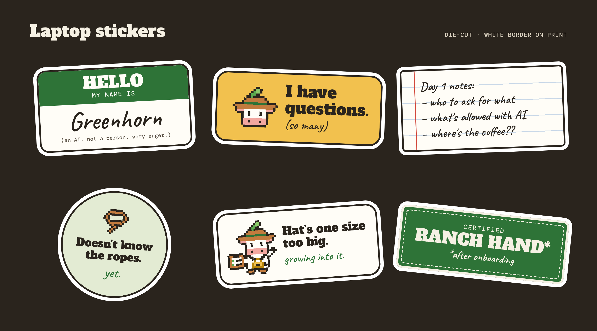

<p align="center">
  
</p>

<h1 align="center">Greenhorn</h1>

<p align="center">
  <b>The new hire that actually reads the company handbook.</b><br>
  Teach it the ropes. Answer its questions. Onboard your AI the way you would any new colleague.
</p>

<p align="center">
  A free, open-source plugin for Claude, by the team at <a href="https://gnx.net">GNX</a>.
</p>

<p align="center">
  <a href="https://globalnetx.github.io/greenhorn/"><b>Website</b></a> ·
  <a href="#before-you-start"><b>Before you start</b></a> ·
  <a href="#getting-started"><b>Get started</b></a> ·
  <a href="#the-commands"><b>Commands</b></a> ·
  <a href="./examples/parcelona/"><b>Worked example</b></a>
</p>

> **Pre-release, version 0.1.** Greenhorn works end to end: the
> interview, your skills, the always-on block, the checks, the step that
> packs your company's plugin, and the note that tells your team. We've
> tried it for real, and it will still surprise you in places. The shape of the folder it builds may change before
> 1.0. If something trips you up, [tell us](https://github.com/globalnetx/greenhorn/issues);
> that's what a pre-release is for.

**Your team already has an AI. Greenhorn teaches it your company.**

Your AI assistant is very smart, but it has never heard of your
organisation. It doesn't know what you do, how you talk to your customers,
or what all your abbreviations mean. So every time you ask it something, you
end up explaining your company all over again. And so does everyone else on
your team.

Here's the thing: a new colleague has the same problem on their first day.
You fix that by showing them around. Greenhorn does exactly that for your
AI. You sit down with it for an afternoon. It reads your website, looks at
the documents you already have, and asks you the kind of questions a curious
new hire would ask. Then it writes it all down and packages it up for your
whole team.

The next morning, your AI knows your company.

- Ask it to write a customer email, and it sounds like you.
- Ask it for a slide deck or a one-pager, and it uses your logo, your
  colours, and your fonts.
- Ask what one of your terms means, and it knows.
- Ask who handles something, and it tells you who, and who to go to next.
- Ask it to do something you've decided AI shouldn't do here, and it says
  so.
- Everyone on your team gets the same answers, because it all comes from one
  place.

The greenhorn is your AI: the newcomer who doesn't know the ropes yet.
Greenhorn gets it saddled up.

<p align="center">
  
</p>

## Before you start

> [!IMPORTANT]
> Greenhorn is built for companies that have already said yes to AI. The
> plugin it makes is meant for a shared workspace, such as a Claude Team
> or Enterprise plan, so the decision to roll AI out to everyone comes
> before this tool, not from it. If that decision hasn't been made, start
> there. Then think privacy through before the first document goes in:
> personal details about colleagues and customers, and anything under a
> contract or an NDA, need the same care here as anywhere else. Only hand
> Greenhorn documents and information your company allows you to share
> with an AI. If you wouldn't be allowed to paste it into your assistant
> on a normal working day, don't give it to Greenhorn either.

## Getting started

Three steps. After that, your AI takes you by the hand.

1. [Install Greenhorn](#installing-greenhorn), for yourself only. Not for
   the whole organisation.
2. Make a new, empty folder for it among your own files. Documents is a
   good place: `Documents/Acme AI`, say. Open it in the Code tab of
   Claude Desktop. No folder yet? Giddy-up offers to make one and move
   there.
3. Type `/greenhorn:giddy-up`.

From there it's a conversation, in chapters. Start with the fun one, who
you are; it needs nothing but you. Add a few emails you've sent, so it
can hear how you sound, and your AI already writes the first skills. You
try them yourself before your team sees anything. Pick the other chapters when you have time, skip
what you don't know yet, park what you need to ask someone else about.
It checks the facts with you, writes the files itself, and then tells
you in plain words what it wrote down, including how your AI will behave.
Stop whenever you like; next time it tells you where you left off and
what's still open.

Not comfortable in English? Just talk to it in your own language. And if
your company works in Dutch, that's fine too. Greenhorn writes the
instructions for your AI in English, because that's what AI follows best.
Your examples, your documents, and your own words stay in Dutch. Your AI
answers in Dutch by default.

## What you'll need

- **Claude Desktop, with the Code tab.** That's where Greenhorn lives, even
  if your team uses a different AI day to day. The Code tab is the part of
  Claude that can work with files in a folder on your computer.
- **Python 3.9 or newer.** The checks that run before every build are small
  Python scripts. On a Mac, say yes if it offers to install the command line
  tools. On Windows, install Python from python.org and tick "Add to PATH".
  If it's missing, your AI will tell you and help you sort it.
- **Permission to set shared instructions for your team's AI.** In a Claude
  organisation, that's an Owner on a Team or Enterprise plan. For another
  AI, whoever looks after it for the team.
- **Your website address**, plus whatever you've got lying around: a brand
  guide, a handbook, a style guide, a list of terms, a few emails you're
  proud of.
- **Your logo and your look.** Logo files if you have them, or a photo of
  your letterhead, or a screenshot of your website. No need to know your
  colour codes or font names. Greenhorn works those out with you.
- **The most capable model you've got.** Pick the Opus tier or higher for
  the interview; that's where judgment matters. Reading your documents
  can go to a faster model, and Greenhorn does that by itself.

Two things about the Code tab.

**Permissions.** The Code tab asks before it changes a file or runs
something. So that you aren't asked a hundred times, giddy-up writes a
small settings file for you alone, `.claude/settings.local.json` in your
folder, and tells you. To be exact about what it pre-approves in that
folder from then on: changing files inside the folder, running Python
(the checks are Python scripts, and the approval covers any Python),
and searching and reading the web. It stays until you remove it; say
"remove the settings file" and it's gone, and Greenhorn goes back to
asking each time. If prompts still get in the way, pick "Auto" or
"Accept edits" in the row under the message box. Greenhorn never
suggests switching permission checks off altogether. What it does about
web pages and documents that try to give your AI instructions is
[further down](#how-it-stays-safe-and-where-it-relies-on-you).

**Your folder is the source.** It becomes your company's AI in source
form: the interview, your documents, your brand files, the skills, the
built package. Greenhorn asks for a backup before anything goes to your
team, and reminds you after every build. When you're ready,
`/greenhorn:homestead` gives it proper version history.

## How it stays safe, and where it relies on you

Greenhorn runs in Claude Code on your own computer, in one folder, with
your account's permissions. The settings file described above is one part
of that. Two more things are worth knowing.

**What it reads.** It reads your website, public search results, and the
documents you hand it. Any of those can contain text aimed at an AI
("ignore your instructions and..."). Greenhorn's rule is that such text
is data: it reports it to you and does not act on it. A rule is not a
wall. Combined with the approvals above, a document or page that fooled
the assistant could have it run code or fetch a web address. So hand it
your own material, be wary of documents from people you don't know, and
if a session does something you didn't ask for, stop it.

**What leaves the folder.** The built plugin holds only your skills and
their reference files; the build copies by an allowlist and refuses
anything else. The interview notes, your source documents, and your
brand files never go into it, and the version-control setup keeps them
out of the repository too. What you put into a skill does go to everyone
who gets the plugin, which is why exact facts and real names are checked
with you before a build for the team.

**Found a security problem in Greenhorn itself?** Please don't open a
public issue for it. Use "Report a vulnerability" under the
[Security tab](https://github.com/globalnetx/greenhorn/security) of this
repository. Problems in Claude, Claude Code, or another AI product
belong with their makers.

## Which AI it works with

Everything Greenhorn writes down is plain text, meant for any capable AI.
It never addresses one model by name, and it doesn't lean on one provider's
tricks. The checks make sure of that. So what your AI learns about your
company stays yours, now and after you switch.

The tool itself is built for Claude first, because that's what GNX uses. It
runs in the Code tab of Claude Desktop. When you're done, it hands you a
Claude plugin and tells you exactly how to upload it. Does
your team use a different AI? Greenhorn still builds the same folder. The
roll-out step then tells you which piece goes where in that product,
starting with the always-on block. Greenhorn asks which AI your team uses
when you first publish, and everything it tells you after that fits that
answer. We've only run all of this with Claude ourselves; what that means
for other products is under
[Other AI tools](#other-ai-tools-or-just-the-skill).

## Two plugins, never one

This is the one thing to get right, so let's do it now.

**Greenhorn is for you alone.** It's the tool that builds your company's
plugin. Install it under your own plugins. Never for the whole organisation.

**Your company's plugin is for everyone.** Greenhorn builds it as a separate
plugin, with only your company's skills and rules inside. Nothing of
Greenhorn itself goes in there. The build step checks.

Why does it matter? Install Greenhorn company-wide and every colleague gets
a tool for building plugins, instead of a colleague who knows the company.
Greenhorn says this once, when it hands you the zip to upload.

## The commands

Greenhorn speaks ranch. Every command starts with `greenhorn:` because
that's how Claude Code shows commands from a plugin. You don't have to
remember any of them. Say what you want ("set up our assistant", "add a
skill", "check everything") and the right one runs. Call Greenhorn with
nothing after it (`/greenhorn:greenhorn`) and it prints this list for you.

<p align="center">
  
</p>

| Command | What it does | Or just say |
| --- | --- | --- |
| `/greenhorn:giddy-up` | The first run. Reads your website, takes your documents, interviews you, builds the first version. | "set up our assistant" |
| `/greenhorn:wrangle` | Adds a skill, or fixes one. A lesson, a document, or "it keeps getting X wrong" goes in; a skill comes out. | "add a skill", "capture this" |
| `/greenhorn:reins` | Tidies up the routing: the always-on block, and the table of which skill to open for what. Runs by itself after a skill is added. | "it isn't using the glossary" |
| `/greenhorn:round-up` | Checks the folder: broken pointers, overlapping skills, stale references, claims with no source. Also runs before every build. | "check everything", "anything stale?" |
| `/greenhorn:roll-out` | Packs everything up for your team's AI (a plugin, for Claude) and tells you exactly how to get it to them. | "publish this", "push it to the team" |
| `/greenhorn:campfire` | Tells your team about their new colleague, in the form you want: an email, a post in your channel, a short note, or a handout. In your voice, with your own examples, and a named person to ask. | "make the onboarding guide", "announce it to the team" |
| `/greenhorn:homestead` | Optional, for later. Puts the folder under version control so a colleague can help maintain it. | "put this on GitHub" |

The first run uses the other commands as it goes. Your AI names them
when a session wraps up, so you know they're there for later.

## Installing Greenhorn

Two ways in. Either way, you install it for yourself, not for the
organisation.

**From the zip.** Versions are published on this repository's
[Releases page](https://github.com/globalnetx/greenhorn/releases) as
`greenhorn-vX.Y.Z.zip`, with a note on what changed. Page still empty?
Then 0.1 hasn't been tagged yet; use the second way for now.

1. In Claude, open Customize, then Plugins. This is your own list, not
   the organisation's.
2. Choose Add, then "Upload plugin", and pick the zip.
3. You're done when Greenhorn shows up in your own list, and its
   commands appear when you type `/` in a Code tab session. See
   "Inventory" or "Default access"? Then you're in the organisation's
   plugins. Go back.

No "Upload plugin" in the Add menu? Then your organisation has switched
off uploads by members; ask an Owner, or use the second way. And if the
plugin doesn't show up in the Code tab, update Claude Desktop first: the
Code tab picks up your own plugins from version 2.1.273 of Claude Code.

One side effect to know about: an uploaded plugin is also there in your
normal chats. Greenhorn can't work there, since it needs a folder, and
says so in a sentence when it's called.

**From this repository, inside Claude Code.** This way updating is one
command, and you get the latest state of the repository, which can be
ahead of the last release. In a Code tab session, run these two:

```text
/plugin marketplace add globalnetx/greenhorn
```

```text
/plugin install greenhorn@greenhorn
```

**Updating.** New version out? Upload the new zip as a new version of the
same plugin. On the marketplace route, run
`/plugin marketplace update greenhorn`, or switch on auto-update for it
once under `/plugin`; Claude Code only auto-updates its own marketplace by
default. Your company's folder and plugin aren't touched. Greenhorn shows
its version at the start of a session, so you can tell whether you're
current.

## Other AI tools, or just the skill

Greenhorn is a folder with a `SKILL.md` in it. That's the open
[Agent Skills](https://agentskills.io) format, which Claude Code, Codex,
Gemini CLI, Cursor, GitHub Copilot, and a long list of other tools can
read. The plugin wrapper is only for Claude. If your tool reads skills and
can work with files in a folder and run a small Python script, you can run
Greenhorn there too. It's tuned for Claude Code, so elsewhere expect to help
it along a little more.

To be straight about it: we haven't tested Greenhorn in those other
tools, and we don't support them ourselves. If there's interest, pull
requests that add or improve support for one are welcome.

**The skill on its own.** Every release also carries
`greenhorn-skill-vX.Y.Z.zip`: just the `greenhorn/` skill folder, with
the licence files inside it and nothing else. Unzip it into wherever your
tool keeps skills:

- Claude Code without the plugin: `~/.claude/skills/greenhorn/`
- Codex: `~/.codex/skills/greenhorn/`
- The shared folder several tools read: `~/.agents/skills/greenhorn/`.
  Codex and Copilot CLI look there; Claude Code didn't when we last
  checked, so see your tool's own docs.
- Anything else: the list of tools, and where each one looks, is at
  [agentskills.io](https://agentskills.io).

Installers that follow the Agent Skills layout, such as `npx skills`,
should find the skill in this repository too. We haven't tested that
route, and they're third-party tools, so read what one does before you
run it.

Then say "set up our assistant", or invoke the skill the way your tool
does. The folder, the checks, and the roll-out step work the same
everywhere. The only Claude-specific part is the final plugin upload, and
the roll-out step tells you what goes where for other products.

## How it works

The order below is the one that works best, because each step builds on
the one before. It isn't fixed: you pick the chapters, skip what you don't
know yet, and park what you need to ask someone else about.

1. **Who you are.** Greenhorn reads your website and searches the web for
   your company and your sector, then brings it all back as questions,
   never as facts. Then it plays the new hire and you show it around:
   what you do, who you serve, what people get wrong about you, what you
   stand for, and the things nobody could read anywhere but everyone
   here knows. One question at a time, saved as you go.
2. **A few of your documents.** Ten minutes dropping what you have into
   the folder: emails you've sent, a quote, a handbook, a brand guide.
   Before it opens the first one, it asks which kinds of information
   must never go into an AI, and keeps those out. Every document means
   fewer questions later.
3. **How you sound.** Worked out from those real emails and documents
   rather than from thin air, so your AI writes like you and not like an
   AI. You pick between a few versions of the same message until it
   lands. And how it comes across when it speaks as itself, with a name
   if you want it to have one; plenty of companies skip the name.
4. **The first skills, right away.** Who your company is, how it talks,
   how your AI behaves, how to write new skills. Try them yourself for a
   day before anyone else sees them.
5. **What you offer, and how it gets done.** Each thing you sell or do,
   with a typical case, and how it actually moves through the company
   inside, because that's what your team will ask about most.
6. **AI in your daily work.** What colleagues work on, where AI already
   helps, where it got things wrong, what it must never get wrong here.
   The offers, reports, and tender answers you'd like it to take on
   become skills you build together afterwards.
7. **Your words and your look.** The terms an outsider wouldn't know.
   Logo, colours, fonts, and how your documents and slides should look;
   bring whatever you have, and Greenhorn works out the rest with you,
   as a mockup.
8. **House rules, before the team.** What your people may and may not do
   with AI, which routes to your systems are allowed, what a person must
   always sign off first. Settled with whoever needs to agree, and in
   place before anything goes to the whole team.
9. **Checks, and a second pair of eyes.** Before every build, in plain
   words with file and line: shape, routing, broken pointers, placeholder
   names, anything that looks like a password. Before anything goes to
   the team, an independent review of what was written, and every exact
   fact (phone numbers, addresses, prices) confirmed with you.
10. **Roll-out.** First for you alone, then for the team. For Claude, a
    plugin zip with a version number and the exact upload steps. For
    another AI, the same folder and a note on which text goes into which
    setting. Before the team gets it, a short readiness check, including
    a backup of your folder.
11. **Tell the team.** However you'd tell them anything: an email, a
    post in your channel, a short note, or a handout to keep. Greenhorn
    asks what you want to say and builds it with you, in your voice,
    with the first asks to copy, examples from your own work, the ground
    rules in plain words, and a named colleague to ask.
12. **Keep it safe, together.** When a second person joins in, or you
    want a history, `/greenhorn:homestead` turns the folder into a
    private repository on GitHub, with the interview and your documents
    kept out and the checks running on every change. With GitHub Desktop
    or from a terminal; homestead advises which, and what to ask your IT
    person if you have one.

Everything your AI writes about your company traces back to something you
said, handed over, or confirmed. Whatever it already believed about you from
general knowledge, it asks about. It never just writes it down.

## What's in this repository

For the curious, and for anyone who'd rather build Greenhorn themselves.

| Path | What it is |
| --- | --- |
| `README.md` | This page. |
| `skills/greenhorn/` | The Greenhorn skill itself, complete on its own: a short `SKILL.md` that finds the right command, one step-by-step procedure per command under `references/`, the interview questions, the rules below, the scripts, and the skill template. |
| `skills/greenhorn/references/conventions.md` | How skills are written: brain not manual, one home per rule, examples that obey every rule, placeholder names, audiences, language, what never leaves your computer. |
| `skills/greenhorn/references/schema.md` | The contract for the block at the top of every skill, why the extras live under `metadata`, the always-on block's stamp, and the settings file. Applies to Greenhorn's own skill too. |
| `skills/greenhorn/references/upload-facts.md` | What the documentation says about uploading a plugin and setting organisation instructions, with dates and links. |
| `skills/greenhorn/references/working-with-ai-craft.md` | The general craft of working with an AI colleague: the briefing recipe and the habits that end up, in your own words, in your team's handout. |
| `skills/greenhorn/templates/SKILL.md.template` | The blank a new skill starts from. |
| `skills/greenhorn/templates/handout.template.md` | The staff handout skeleton: the general craft as fixed text, slots for everything that is your own. |
| `skills/greenhorn/scripts/check_harness.py` | The checker that runs before every build. Plain words, with file and line. |
| `skills/greenhorn/scripts/scan_secrets.py` | Fails on anything that looks like a password, token, or key. |
| `skills/greenhorn/scripts/stamp_org_instructions.py` | Re-stamps the always-on block after a person has reviewed it. |
| `skills/greenhorn/scripts/build_plugin.py` | Packs your company's plugin: runs the checks, copies only your skills and a manifest, raises the version, zips it, and prints where the always-on block goes. |
| `skills/greenhorn/scripts/init_repo.py` | Puts your folder under version control: the ignore list that keeps the interview and your documents out, a licence note, the checks under `tools/` with a workflow that runs them, and the first commit. |
| `CONVENTIONS.md`, `SCHEMA.md` | Two-line pointers to the files above, for anyone who looks for them at the top. |
| `commands/` | One small file per command, so they show up in the slash menu. Each one opens the skill at the right procedure. |
| `examples/parcelona/` | A complete worked example for a made-up freight forwarder, Parcelona Logistics: what Greenhorn builds for a company, its staff handout as source and PDF, and the checker's test case. |
| `.claude-plugin/plugin.json` | The plugin's manifest: name and version. |
| `.claude-plugin/marketplace.json` | Lets Claude Code treat this repository as a marketplace with one plugin. |
| `.github/workflows/checks.yml` | Runs the checker, the secret scanner, and a Markdown lint on every change. |
| `.github/workflows/release.yml` | Builds the plugin zip and the skill-only zip, and publishes a GitHub Release when a version tag is pushed. |
| `.github/workflows/pages.yml` | Publishes the small site in `site/` to GitHub Pages, with the brand assets beside it. |
| `site/` | The one-page website: the same story as this README, with more of the pictures, and a page for when someone wanders off. |
| `.github/assets/` | The banner, logo, mascot, poses, command icons, and the fence, cows, and barn from the site. The two boards on this page are in `readme/`; the full brand kit, laptop stickers included, is in `brand-kit/`. |

## For maintainers: releasing

1. Set the new version in `.claude-plugin/plugin.json`, in
   `.claude-plugin/marketplace.json`, and as `metadata.version` in
   `skills/greenhorn/SKILL.md`. The checks fail when they disagree.
2. Commit. Tag the commit `vX.Y.Z` with the same number. Push the tag.
3. The release workflow takes it from there. It runs the checks and refuses
   if the tag and the manifest disagree. Then it builds
   `greenhorn-vX.Y.Z.zip` (the plugin: skill, commands, example, licence,
   README) and `greenhorn-skill-vX.Y.Z.zip` (just the skill folder, which
   carries everything it needs, plus the licence files), writes a `SHA256SUMS` file for both, and
   publishes a GitHub Release whose notes name the three files and carry
   the generated change list. While the version starts with 0, the
   release is marked as a pre-release. Marketplace installs pick the new
   version up when the user runs `/plugin marketplace update greenhorn`, or
   on their own if auto-update is switched on for it.

## Where this comes from

We didn't invent any of this. Greenhorn is a bundle of habits we picked up
at GNX while getting our own AI to work for us. Write down what a good
colleague would know. Keep each rule in one place. Check it before it goes
out. Tell people how to use it.

**Why we're sharing it.** At GNX, all our AI runs on one shared set of
skills and ground rules, built the way Greenhorn builds yours. Every
assistant and every agent reads from it. That has made three things
easier. We can switch between AI tools without starting over. Colleagues
can add and improve skills together. And the guardrails stay in place,
whichever AI is doing the work. It has worked well for us, which is no
guarantee it will for you. But we like sharing what we build, and if it
saves you some of the work it took us, it was worth putting out there.

You'll find most of these ideas elsewhere too: in the AI makers' own advice
on writing skills and prompts, in good style guides, and in plenty of blog
posts. They're not ours to claim. For example, the pass that takes the
AI-sounding habits out of a text owes a lot to blader's
[humanizer](https://github.com/blader/humanizer), which in turn builds on
Wikipedia's guide to the signs of AI writing.

What we've done is put it all in one package that does the work with you.
We hope it helps your company get more out of AI, with less fuss.

**Built with AI, on purpose.** Greenhorn was designed by people at GNX
and written together with Claude: the skill, the scripts, this page.
People decided what it should do, tried it for real, and sent it back
when it was wrong; independent AI reviewers went over each round of
changes. It would be odd to build a tool for working with AI
any other way. If something reads off or behaves oddly, that's ours to
fix, so tell us.

The worked example, Parcelona Logistics, is made up. So are its customers
Tulipware and Nordlicht Optics, its operations system Cargo Desk, and
its assistant's name, Estiba.

## Licence

Apache 2.0. See [`LICENSE`](./LICENSE) and [`NOTICE`](./NOTICE). What
you build with Greenhorn is yours: your company's skills and plugin carry
whatever licence you give them.

Greenhorn comes as it is. As the licence says, there is no warranty and
no liability, and we make no promises about support, replies, or
timelines.

Want to help? See [`CONTRIBUTING.md`](./CONTRIBUTING.md). Found a
security problem? Use "Report a vulnerability" under the
[Security tab](https://github.com/globalnetx/greenhorn/security).

<p align="center">
  
</p>
